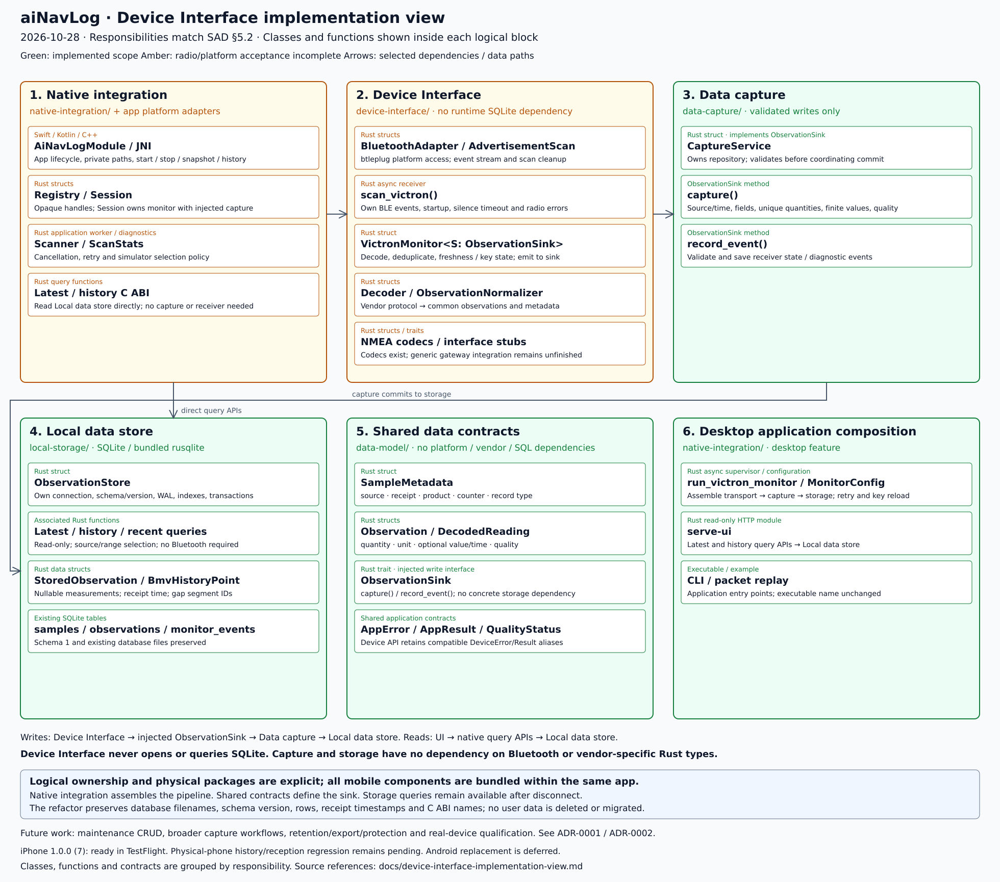
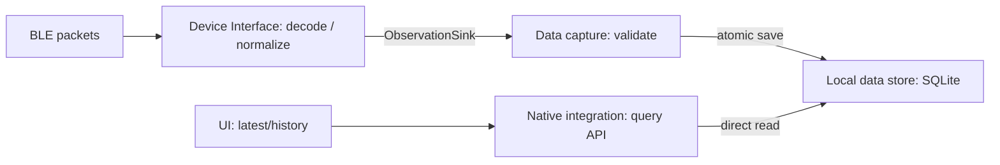

# Device Interface implementation view

Reviewed October 28, 2026. This view shows Device Interface and its surrounding
capture, storage and application-integration boundaries. Responsibilities match
[SAD §5.2](../architecture.md#52-building-block-responsibilities), with Device
Interface internals in [§5.4.3](../architecture.md#543-device-interface).

[Full-resolution PNG](images/device-interface-implementation-view.png) ·
[Zoomable SVG](images/device-interface-implementation-view.svg) ·
[Mermaid dependencies](images/device-interface-implementation-view.mmd).
Regenerate with `python3 docs/diagrams/render-device-interface.py`.

## Responsibility and source map

| Logical responsibility | Physical code | Scope |
| --- | --- | --- |
| Native/application integration | [C ABI and sessions](../native-integration/src/lib.rs), [mobile worker](../native-integration/src/mobile.rs), Swift/Kotlin/JNI under `user-interface/modules/ainavlog/` | Translate app calls, supply private paths, assemble dependencies and manage lifecycle. Latest/history queries call storage directly. |
| Device Interface | [Bluetooth adapter](../device-interface/src/bluetooth.rs), [BLE event loop](../device-interface/src/receiver.rs), [monitor](../device-interface/src/monitor.rs), [Victron decoder](../device-interface/vendor/victron/mod.rs), [normalizer](../device-interface/src/normalizer.rs) | Transport, protocol/source interpretation, normalization, duplicate/freshness/key state and reports. No runtime database dependency. |
| Data capture | [CaptureService](../data-capture/src/lib.rs) | Validate normalized packet envelopes and coordinate committed writes/events through storage. |
| Local data store | [ObservationStore](../local-storage/src/lib.rs) | SQLite schema, atomic transactions, indexes, latest/history queries and persistence. Accept shared metadata, not vendor types. |
| Shared contracts | [data-model](../data-model/src/lib.rs) | `SampleMetadata`, `Observation`, `DecodedReading`, quality/errors and `ObservationSink`; no platform/vendor/storage dependencies. |
| Desktop application composition | [supervisor](../native-integration/src/desktop.rs), [CLI](../native-integration/src/main.rs), [HTTP queries](../native-integration/src/ui_server.rs), [replay](../native-integration/examples/replay_bmv.rs) | Assemble the same receiver → capture → storage path; expose read-only browser queries independently. |

## Writes and reads

`VictronMonitor<S: ObservationSink>` receives its sink at construction. Native and
desktop composition inject `CaptureService`, which owns an `ObservationStore`.
The monitor emits shared metadata plus normalized observations; capture validates
source/receipt consistency, required fields, unique quantities, finite values and
missing-value quality. Storage commits packet/observations atomically. Only a
successful capture advances freshness and duplicate state. Receiver events also
pass through capture. Device Interface never opens SQLite or serves history.

`ainavlog_latest` and `ainavlog_history` call Local data store directly. History is
available after disconnect without opening a receiver or requesting Bluetooth
permissions. Platform wrappers expose `start`, `stop`, `snapshot`, `history`.
C-compatible `ElectricalSample` carries receipt time, presence bits and house
voltage/current/SOC plus starter voltage. `HistoryPoint` adds a segment ID.
No Rust allocation crosses the C ABI; callers own output buffers.

## Radio and lifecycle

Application integration owns the mobile worker, cancellation and session registry;
`device-interface::receiver::scan_victron` owns btleplug BLE events, scan startup,
cleanup and radio errors. iOS uses btleplug's CoreBluetooth backend and Android
uses its Java/JNI backend. Swift/Kotlin do not implement independent scanners.
The integration's public simulator policy selects company `0x02e1`, synthetic
product `0x1234`, Battery Monitor record `0x02` and the public test key, mapping
changing OS identities to one logical source. Real instrument selection/private
mobile keys remain separate work. Silent reception restarts after 30 seconds with
a three-second retry delay. Backgrounding stops the worker; UI connection intent
controls foreground resumption. No background recording is implemented.

The decoder also supports DC/DC `0x04` and Orion XS `0x0f`; the mobile simulator
policy does not enable them. `Nmea0183Codec` and `Nmea2000Codec` handle complete
messages; gateway/framing/observation integration and AIS payload assembly remain
unfinished. Generic `ConnectionManager`, `TransportAdapter` and
`DeviceProtocolAdapter` remain operational stubs outside the active path.

## Storage compatibility and history

The extraction preserves database paths, application ID, schema version 1 and
existing samples/events. No user database is deleted or migrated. Queries retain
nullable measurements and original receipt timestamps; live UI hides stale values,
while history renders saved values without applying live freshness hiding.

`read_bmv_history(path,source,start,end)` uses `[start,end)` (maximum 32 elapsed
days), returns empty for a missing file without creating one, and preserves actual
bucket endpoints/extrema over 360 buckets. Segments split at receipt gaps over five
seconds or measurement availability changes. Over 8192 selected points returns an
error asking for a shorter range rather than silently truncating. Desktop
`GET /electrical/history?start=...&end=...` uses the same query.

## Packaging and acceptance

The Rust C ABI package is now physically `native-integration/`; its package/library
name and exported ABI names are unchanged. The EAS source staging script includes
all five sibling crates within the existing app upload directory. Desktop commands
run from `native-integration` with `--features desktop`; the executable retains its
existing name. See [ADR-0001](decisions/0001-sqlite-local-storage.md) and
[ADR-0002](decisions/0002-capture-storage-boundaries.md).

Owner confirmed iPhone build 6 simulator reception October 26/28. Android code 7
initialized in the emulator; physical tablet testing is deferred. Those results
predate this refactor/history API. Replacement mobile binaries and physical-phone
regression remain pending; no new release/submission is implied by source tests.
Maintenance schema/CRUD, real BMV/Orion qualification and storage lifecycle policies
remain unfinished. See the [phone checklist](bmv-phone-test.md),
[October 28 checkpoint](status/status-2026-10-28.md) and companion
[UI implementation view](user-interface-implementation-view.md).

**Delivery update — October 28:** iPhone 1.0.0/build 7 compiled and its exact
TestFlight submission finished successfully, including the history API and
responsibility refactor. Physical-phone regression remains pending. Existing
Android code 7 predates these changes; its replacement is deferred until the
physical tablet arrives. See the [release checkpoint](status/status-2026-10-28.md).
