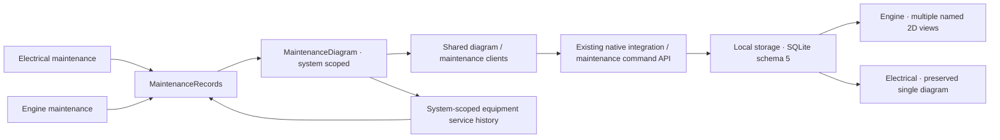

# Engine maintenance — multiple 2D views

Implemented in source November 24, 2026. Windows test delivery is
`aiNavLog-Setup-0.1.4.exe`; see [Windows delivery](windows-delivery.md).
A new native mobile build and physical acceptance remain pending; no mobile cloud
build or submission was requested by this change.

## User flow

Home → Engine → Maintenance Logs reuses the same maintenance service and diagram
interaction as Electrical. The engine is a 3D object represented by multiple 2D
images, rather than a reconstructed or rendered 3D model.

1. Select **Add diagram** (or **Add/update diagram** for further images) and upload a JPEG or PNG (up to 6 MB, dimensions up
   to 20,000 pixels). Label it Upper view, Port side view, Starboard side view or
   Bottom view. Front, Rear and custom names are also supported.
2. Mark components on the image and enter equipment details, or link existing
   engine/shared equipment. The engine type list includes filters, pumps, belts,
   heat exchangers, starter motors and other engine components.
3. Save the view. Upload each additional view separately. Image regions are local
   to each view; linked equipment IDs are shared, so a filter visible from above
   and from the side has one equipment record and one Engine service history.
4. Swipe left for the next saved view and right for the previous. Engine uses the Electrical layout and controls; it has no separate view menu
   or Previous/Next buttons. A small counter identifies position in the set. Navigation
   stops at the first/last view; order follows view creation order.
5. Tapping a component opens its latest Engine service summary; touch-and-hold
   opens equipment editing. Mouse hover displays the same summary used by
   Electrical. The component dialog opens filtered Engine service history, where
   completed work uses the existing shared form/service/SQLite path.

A short drag, vertical scroll, multi-touch or cancelled gesture does not change
views. Swipes do not navigate while reviewing unsaved image/marker changes.
Electrical retains its single 2D diagram workflow and touch/mouse behavior. Its
example image is not used as an Engine example. No engine images or service
records are seeded into the app.

When uploading, choose **Replace current view** in the review to update only the
selected view, or keep **Add as new view** to retain all saved views. Review equipment links
again before saving. Cancel preserves saved views and records. Updating one view
never deletes other views, equipment or service records. Supported scope is
uploaded 2D images and reviewed markers; automatic scanning, image-to-3D
reconstruction, PDF import and engine telemetry are outside this change.

## Shared implementation



- `MaintenanceDiagram.tsx` holds shared upload, review, markers, dialogs and hover.
  `ElectricalDiagram.tsx` is a compatibility wrapper.
- `use-view-swipe.ts` captures deliberate one-finger horizontal engine gestures;
  normal child presses, holds and vertical scrolling retain their behavior.
- `/mech/service-history` mirrors `/elec/service-history` with Engine ownership.
- The model helpers accept system scope and preserve shared equipment identities.
  A component can appear in multiple views without duplicating its equipment or
  completed service records.

## Persistence and compatibility

Schema 5 migrates the old `electrical_diagram` singleton into
`maintenance_diagrams(system,id,name,body)` as Electrical ID `main`. It retains
image chunks, stable equipment IDs, equipment metadata, telemetry and service
history. The legacy-named `electrical_diagram_assets` table remains a shared
image-chunk store for both systems. SQLite is still device local.

`diagram_list` returns bounded ID/name metadata for a system. `diagram_read` and
`diagram_save` take `system` and `diagramId`; saves also take `name`. Omitted scope
retains the Electrical/main command contract. Chunk upload/read uses the existing
16,000-character chunks and 32 KiB request limit. No platform method or C ABI was
added; existing Swift/Kotlin/JNI maintenance transport carries the new commands.

A save validates ownership and regions, verifies complete image chunks, checks
base revision and atomically publishes metadata/equipment. Identical committed
retries succeed. There are at most 50 views per system and 60 regions per view.
Replaced image chunks are deleted only when no saved view references the image.
Published images cannot be discarded. Schema-4 and earlier binaries reject the
new database: do not downgrade after migration; native update retention still
needs physical-device verification.

## Verification

Storage tests cover schema-4 migration and reopen, multiple views, shared component
identity/image references, Electrical isolation, stale revisions, retry handling
and cross-system link rejection. Application command tests cover all four engine
view names and disconnected command routing. UI checks include typecheck, lint,
Node tests and a real Rust/temporary-SQLite browser integration test:

```sh
python3 user-interface/tests/integration/run-diagram-ui.py /tmp/ainavlog-engine-web engine-diagram-ui.cjs
```

Set the browser runtime environment as for other integration tests and export the
web app with the local service endpoint first. The browser test uses a clearly
labeled synthetic engine image, not a real vessel drawing or uploaded owner data.
Browser gesture verification does not replace physical iPhone/Android acceptance.


## Consistency refinement — owner correction

Electrical is the baseline. Both systems use the same maintenance screen, diagram
controls, upload/review, component dialogs, service-history form, tap/hold and mouse
hover behavior. Removed the Engine-only Manage views menu and arrow navigation.
Engine adds finger swipes between its saved views and a small position counter.
View naming and add-versus-replace choices occur during upload review, keeping
view management within the existing Add/update diagram flow.
