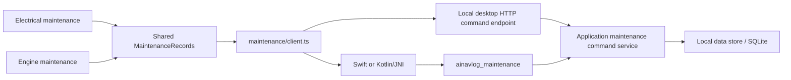

# Shared maintenance implementation

Source baseline: October 30, 2026. This implementation is after iPhone build 8;
it needs a replacement native binary and physical acceptance. Android delivery
remains deferred. No maintenance release has been launched.

## User flow

Home and the Engine/Electrical screens link to Maintenance Logs. The two routes
render `MaintenanceRecords` with fixed Electrical/Engine log scopes. The owner selects
existing equipment or adds a named engine/electrical/both item, then records
completed service, inspection, repair or replacement. Equipment may be available in both systems, but each new service entry belongs
to the log from which it was recorded. No all-systems switch is shown. A per-equipment filter narrows history.

Required: equipment, work date and description; the screen supplies log ownership. Optional: performer/provider,
manual equipment hours, parts/quantities, cost/currency, invoice/survey reference,
findings/notes and next date/hour threshold. Work dates remain date-only values;
record creation uses separate Unix milliseconds from the device clock. Unknown
hours/cost remain null, and zero is a valid explicit value. Two-decimal costs are
stored as integer minor units, not floating-point currency amounts. Date validation
includes month lengths/leap years; UI rejects future completed-work dates. Native
validation checks record shapes, finite bounded hours, dates and currency pairing.

Records are currently append-only. The form preserves values after save errors,
and one stable ID is reused for retries. Replaying identical saved content succeeds
without inserting a duplicate; conflicting ID reuse fails. A successful save is
reported only after SQLite commit. If a later history refresh fails, the UI says
that the record was saved and offers refresh rather than asking for another save.

[Service-history preview](images/maintenance-implemented.png) was captured against
a temporary real SQLite database. No fake service records are loaded into the app.

## Runtime boundaries

Manual service entry bypasses Device Interface and instrument Data capture.
The shared application service lives in `native-integration/src/maintenance.rs`;
record validation/storage live in `local-storage/src/maintenance.rs`. The native
module returns JSON text, parsed by the TypeScript command client. It works without
Bluetooth permissions, a connected receiver or current telemetry. Mobile history
uses the same SQLite file as existing telemetry; the old simulator-oriented file
name does not classify manually entered service records as simulated data.

`POST /maintenance` exists only for the loopback development service. Requests are
limited to 32 KiB and require the configured Origin and JSON content type. Native
callers provide an output buffer (2 MiB); capacity errors never return partial JSON.
Snapshots fail explicitly above 10,000 records; pagination remains future work.

## Persistence and migration

`ObservationStore::initialize` accepts schema 0/1/2 for the app's application ID.
Its transaction creates the existing telemetry tables as needed and adds:

- `maintenance_equipment`: stable ID, name and engine/electrical/both classification.
- `maintenance_entries`: stable idempotency ID, foreign-key equipment ID, service
  date, creation time and validated JSON record, with an equipment/date index.

The transaction sets `user_version=2`. Version-1 telemetry is not rewritten or
removed. Newer/unrelated databases are rejected. Schema-1 app binaries will reject
schema 2; downgrade support is not implemented. The current app has one vessel
dataset; a rename in preferences does not create another vessel or partition.

## Current limits and next work

Next thresholds are stored with completed work and displayed as date or hours,
whichever comes first conceptually. There is no scheduler, live engine-hour
integration or overdue inference. No receipt/photo upload, signature verification,
correction audit UI, delete, PDF/CSV export, cloud sync or backup is implemented.
Original service documents remain external. The app makes no insurance acceptance
or regulatory-compliance claim. See the [research baseline](research/pleasure-vessel-maintenance.md).

## Verification

Storage tests cover schema-1 migration preserving telemetry, reopening service
records, retry idempotency/conflicts, foreign-key rejection, Unicode, exact cents,
optional/invalid hours and calendar dates. Application/C ABI tests exercise
commands disconnected, caller buffers and real C linkage. Desktop+mobile-feature
Rust clippy runs with warnings denied. Browser tests use real SQLite/service/UI
and cover invalid dates, lost acknowledgement followed by retry, reload,
Engine/Electrical shared visibility, custom equipment, filters and unknown hours.
Phone Swift/Kotlin/JNI compilation and physical acceptance still require a new
native build; host/browser tests do not establish them.

## Separate log update — October 30, Windows 0.1.1

Home's Electrical and Engine widgets open distinct named maintenance screens.
Equipment choices and newly added equipment stay within that screen's system;
shared equipment remains selectable from either log, but new entries carry their
own `system` field. Storage rejects an entry assigned to incompatible equipment.
The UI does not mix new records between logs or provide cross-system tabs.

Existing unscoped records retain their JSON and IDs. Where equipment belongs to
only one system, that supplies the existing record's view. Older work on shared
equipment appears only when the owner opens the explicitly labeled Earlier shared
records disclosure; it is not silently assigned to one log. The optional JSON
field requires no schema/table migration and keeps legacy retries compatible.
Use the updated binary for the new field; older 0.1.0 readers cannot interpret
new scoped JSON records. This is one shared implementation, not duplicate code or
separate database files.
