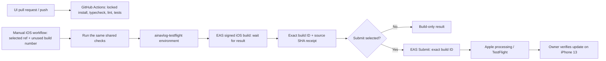

# aiNavLog CI/CD — iOS first

Prepared October 20, 2026. Workflows are implemented locally; a GitHub run, cloud
build, Apple upload and installed update have **not** yet been demonstrated.
Android delivery automation follows after the iOS path is verified. The shared
checks already cover the common React Native/TypeScript code for both platforms.

## Pipeline



Files:
- `.github/workflows/ainavlog-checks.yml`: pull requests and pushes changing the UI
  or these workflows; also reusable by the iOS release workflow. No release secrets.
- `.github/workflows/ainavlog-ios.yml`: manual `workflow_dispatch` only; checks must
  pass before the release job. Optional submission defaults off.
- `user-interface/scripts/ci-ios.mjs`: validates app/project/store identity and
  runner-only build number; accepts only one completed iOS build for submission.
- `user-interface/scripts/eas-ios.mjs`: UI-root archive scope, demo-mode environment
  and optional pinned CLI override. CI uses EAS CLI 24.13.0 and Node 24.21.0.

These checks do not establish Bluetooth reception, native Rust integration, phone
SQLite or physical instrument compatibility. Builds still explicitly use demo mode.

## One-time setup

1. Publish the reviewed workflow and UI helper changes to this repository. The
   manual workflow must exist on the default branch (`main`) before GitHub exposes
   its Run workflow control. Check Actions permissions allow the used actions.
2. In [repository environments](https://github.com/amanlig/aiNavLog/settings/environments),
   create `ainavlog-testflight`. Restrict deployment refs to approved branches and
   configure an appropriate reviewer if desired. Workflow dispatch is the explicit
   release trigger; environment protection is only effective once actually configured.
3. Create an Expo access token for an account with access to organization
   `kode-komplete-software-services-ltd` and project `ainavlog-mobile` at
   [Expo access tokens](https://expo.dev/settings/access-tokens). Store it as
   **EXPO_TOKEN** in the GitHub environment's secrets. Never put it in source or chat.
4. For Apple submission, assign an App Store Connect API key to this app in EAS.
   From `user-interface/`, run:

   ```sh
   npm run ios:credentials
   ```

   Select the `testflight` profile and the intended Apple team. Under App Store
   Connect API-key management, configure the project to use a key for EAS Submit.
   Existing signing certificates/profiles are managed by EAS; do not rotate them
   unnecessarily. Apple login/2FA and private key handling stay in your terminal
   or the provider portal. The workflow retrieves the assigned submission key
   through EAS; no Apple password or `.p8` GitHub secret is required by this design.
5. Confirm the existing signing identity and profile remain valid, and that the
   API key has submission permission. Configuration is not proof until a real
   non-interactive submission succeeds.

See [Expo CI authentication](https://docs.expo.dev/build/building-on-ci/) and
[non-interactive iOS submission](https://docs.expo.dev/submit/ios/). Keep the manual
[iOS](ios-testflight.md) and [Android](android-manual-deployment.md) paths as fallback.

## First run and acceptance

1. Open Actions → **aiNavLog checks** and confirm the intended commit passes.
2. Open Actions → **aiNavLog iOS TestFlight** → Run workflow. Select the reviewed
   ref and an **unused integer build number above 1**. Check App Store Connect
   **and EAS** first; `2` is an example, not a verified available number. Workflow
   preflight checks format/identity, not remote build-number availability.
3. For the first build-only check, leave Submit unchecked. To demonstrate full
   delivery after credentials are ready, select Submit. A new invocation creates
   a new build: use a fresh number, not the previous successful number.
4. The job installs locked dependencies, authenticates, invokes the scoped EAS
   wrapper and **waits** for build completion. It does not use `--no-wait` or
   `--latest`. Submission receives exactly the validated returned build ID.
5. Inspect the run summary and downloadable JSON receipt: source SHA/ref, version,
   build number, EAS build URL/ID, CLI version and GitHub run/attempt. The receipt
   excludes tokens and signed artifact-download URLs. The runner changes only its
   app.json iOS build number; it does not commit back or change Android's counter.
6. If submission was selected, verify Apple processing and tester availability
   separately. Install the update on iPhone 13, record the actual version/build,
   and repeat demo/navigation/reopen checks. Upload success alone is not an install.
7. On an isolated test branch, temporarily cause an existing check to fail and
   confirm the release job is skipped. Restore it; never deliberately break main.

## Failure and retry behavior

Failed checks block signing/upload. Missing EXPO_TOKEN fails preflight. Build
failure, unexpected identity/version or ambiguous build output blocks submission.
The raw EAS build result stays in runner temp; only the sanitized receipt is
uploaded. Submission failure still leaves the receipt available. Retry submission
of that exact successful build manually with `npm run ios:submit -- --id <BUILD_ID>`
after repairing credentials; do not rebuild or resubmit an artifact Apple is
already processing. Inspect EAS and Apple state before any retry.

A workflow timeout/cancellation does not guarantee cancellation of a running EAS
cloud build/submission. Release jobs are serialized with cancellation disabled;
GitHub may replace pending runs in a concurrency group. Re-running all jobs may
attempt a duplicate build number; choose a new unused number for a new build.
There is no automatic production publication, OTA rollout or Android submission.

## Next: Android

Reuse the shared checks, UI-scoped Android wrapper, exact-build traceability and
manual delivery trigger. Configure Google Play service-account/API access and an
internal-track submission profile first. The initial manual Play release is already
recorded; verify an automated upload and actual Android update independently.

## Evidence still required

- GitHub workflow publication and first passing run.
- Expo token/environment configuration and EAS-managed Apple API-key assignment.
- Completed signed iOS pipeline build and exact-build TestFlight submission.
- Owner-confirmed iPhone update and intentionally failed-check blocking demo.
- Android delivery workflow and Google submission credentials.
