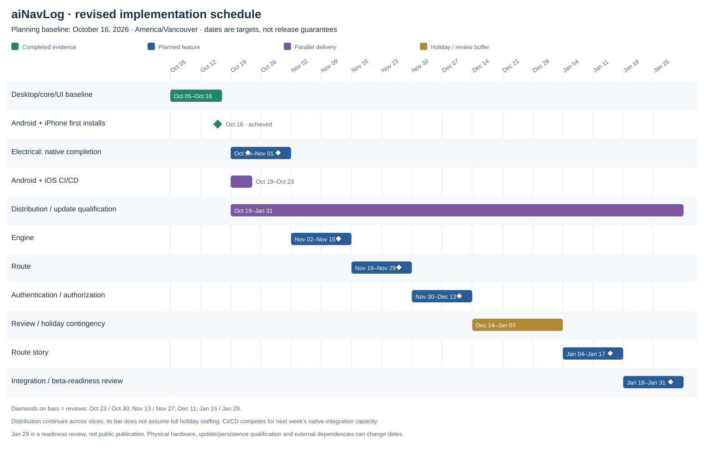
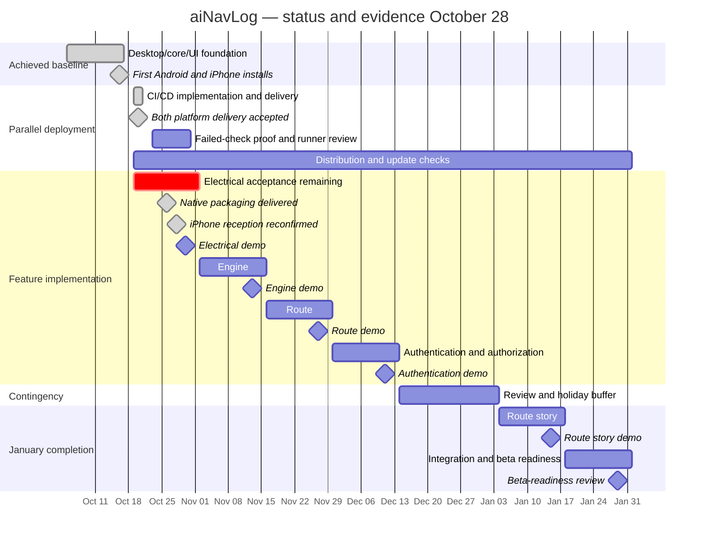

# aiNavLog vertical implementation plan

**Confirmed storage decision — October 28, 2026:** SQLite, accessed through Rust `rusqlite` with bundled SQLite, is the local structured database for the 2027 iOS/Android beta. See [ADR-0001](decisions/0001-sqlite-local-storage.md) for scope, current implementation and remaining work. Existing AsyncStorage preferences and protected credential storage remain separate.

**Created:** October 5, 2026. **Rebaselined:** October 16, 2026. **Status updated:** October 28, 2026,
using the October 26 delivery handoff and October 28 owner-reported iPhone test.
**Target:** implementation foundation for the 2027 mobile beta. Dates use
America/Vancouver. Feature windows are two calendar weeks, with Friday reviews.
These are planning targets, not confirmed delivery or public-store release dates.

## Completion checkpoint — October 28

**Where we are:** the native simulator-to-iPhone electrical path works. We are
qualifying failure/recovery and persistence behaviour, rather than still building
the first receiver. Electrical is not yet fully accepted; Engine has not started.

| Workstream | Recorded status | Remaining work |
| --- | --- | --- |
| Desktop/core/UI foundation | Complete: replay → Rust decoder/normalizer → host SQLite → HTTP → Electrical UI; host-tested C bridge | Maintain regression coverage as native work evolves |
| Shared CI and delivery | Both CI delivery paths demonstrated October 20; later native builds delivered through EAS/store testing | Deliberately failing-check demonstration; runner compatibility review; mobile Rust checks |
| iPhone native Electrical | Build 7 (history + separated capture/storage) built and uploaded to TestFlight October 28; build-6 reception/counters previously owner-confirmed | Install/verify build 7; history with existing/new data; receiver regression, disconnect/reconnect, stale/recovery, permissions and restart/update retention |
| Android native Electrical | Code 7 built and submitted to Play internal testing; emulator reaches connected screen after native-link fix | Physical radio acceptance deferred until tablet arrives; lifecycle and persistence checks remain open |
| Local data store — confirmed beta choice | SQLite through bundled Rust rusqlite accepted October 28 for structured beta records; observations/events implemented | Finalize maintenance schema, stable identities, history/maintenance APIs, migrations, retention/export/deletion/protection; verify restart/update retention |
| UI and architecture visibility | Home/Electrical share sample state; boat name/appearance persist; SAD §§5.4.1/5.4.3 and both implementation images updated October 28 | History chart implementation complete locally (native delivery/acceptance pending); maintenance recording, starter trends/configurable alerts and agreed event/response scope remain unfinished |
| Real BMV / Orion | Decoder support exists; mobile start path deliberately selects public BMV simulator only | Real-device selection/private mobile key setup, hardware interoperability and reference-value comparison |
| Engine, Route, Authentication, Route story | Planned; no completed vertical-slice acceptance | Dependencies and provisional review dates below |

**October 28 test evidence:** independent broadcaster fixture check passed;
a five-minute Windows BLE run produced repeated `Started` statuses. Owner answered
“yes” to readings appearing and receiver packet/update counters increasing on the
iPhone 13. Installed build was not rechecked today; build 6 is the last recorded
iPhone build. Disconnect/reconnect was proposed next but no result has been
reported. Do not infer the other acceptance checks passed.

Evidence: [October 26 handoff](status/status-2026-10-26.md),
[October 28 checkpoint](status/status-2026-10-28.md),
[phone acceptance checklist](bmv-phone-test.md).

**Today’s objective — finalize device-local storage:** retain SQLite/rusqlite; define the history and maintenance contracts, schema/migrations and storage lifecycle, then implement and verify them. Database choice is settled; feature acceptance remains open.

**Next phone acceptance action:** resume the iPhone disconnect/reconnect check, then stale/recovery,
background/resume, permission/Bluetooth and restart-persistence checks. Android
hardware testing is deferred by owner request while the tablet is unavailable.
No new build or store submission is needed merely to resume these checks.

Visual references: [User Interface implementation view](user-interface-implementation-view.md)
and [Device Interface implementation view](device-interface-implementation-view.md).

## Schedule

| Slice | Revised window | Demo / review milestone | Working outcome |
| --- | --- | --- | --- |
| 1. Electrical — native completion | Oct 19–Nov 1, 2026; desktop/core/UI work from Oct 5–18 retained | Native packaging achieved by Oct 26; Fri Oct 30 acceptance review | BMV simulator Bluetooth → phone receiver → Rust decoder → phone SQLite → House/Starter UI, with failure and restart checks |
| 2. Store deployment / beta distribution — parallel | Initial installs achieved Oct 16; demo CI delivery/update acceptance achieved Oct 20; native qualification ongoing | Fri Oct 30 native-build update review; Fri Nov 13 cross-platform evidence review | Reuse signed build paths; validate native updates and stored-reading retention; finish physical Android and native runtime checks |
| 2a. Android + iOS CI/CD — delivery demonstrated | Oct 19–20, 2026 achieved; remaining acceptance open | Both delivery paths verified Oct 20; failed-check gate demonstration still pending | Hosted shared checks, signed builds, receipts and exact-build Play/TestFlight submissions complete; iPhone and emulator acceptance recorded |
| 3. Engine | Nov 2–15, 2026 | Fri Nov 13 | Selected measurements through the shared pipeline; simulated-only scope if hardware/gateway remains unresolved |
| 4. Route | Nov 16–29, 2026 | Fri Nov 27 | Record, save, reopen and display a route; permissions and location gaps explicit |
| 5. Authentication / authorization | Nov 30–Dec 13, 2026 | Fri Dec 11 | Agreed ownership policy, provider/session flows and enforced local-record access |
| Review / holiday contingency — no feature commitment | Dec 14, 2026–Jan 3, 2027 | Availability and remaining-scope review by Fri Dec 11 | Reviews, rework and optional hardening as capacity permits; no assumed full holiday staffing |
| 6. Route story | Jan 4–17, 2027 | Fri Jan 15 | Select saved route/media, preview and explicitly export/share |
| Integration / beta-readiness review | Jan 18–31, 2027 | Fri Jan 29 | Consolidated regression, installation/update, privacy/accessibility and hardware-evidence review; record remaining release blockers |

### Gantt chart



[Open the full-size chart](images/project-plan-gantt.svg). The Mermaid version below
is editable alongside this plan. Task end dates in Mermaid are exclusive, so
Nov 2 represents work through Nov 1. Review diamonds occur within their windows.



The delivery bar spans the programme but does not assume full holiday staffing.
CI/CD delivery was demonstrated Oct 20; failed-check blocking proof remains open.
Native packaging and iPhone simulator reception are achieved as of Oct 26–28.
Electrical Oct 30 acceptance and downstream dates remain provisional; reassess remaining scope/capacity
before treating Engine Nov 2 as a committed start. No replacement dates are assumed.
The Oct 23–30 CI follow-up bar is a review target, not completion evidence.
Public-store release is outside these scheduled milestones.

### October 16 checkpoint and reason for change

- **Android distribution:** signed 1.0.0/code 1 accepted by Google Play internal
  testing; owner confirmed emulator installation and supplied Home launch evidence.
- **iOS distribution:** Apple membership active; signed 1.0.0/build 1 reached
  TestFlight; owner confirmed physical iPhone 13 installation and passed Electrical
  demo, navigation and close/reopen checks.
- **Electrical integration:** desktop/web replay and host-tested Rust/C bridge
  remain verified. The released mobile demo does not include native Rust/Bluetooth
  reception or phone-local SQLite. The original Oct 16 end-to-end milestone is
  therefore **not complete** and moves to Oct 30.

The revised baseline adds two focused weeks for native Electrical completion,
then shifts Engine, Route and Authentication two weeks later. Route Story moves
to January rather than depending on uninterrupted holiday capacity. The original
Oct 5–Dec 13 schedule remains historical; it is superseded by this table.

Jan 29 is a **beta-readiness review**, not a promised public release. Physical
BMV/engine access, device coverage, native integration, event-history scope and
store processing may require further work. Reassess dates at Oct 23 and Oct 30;
do not move to Engine with an unaccepted Electrical gap. No new cloud build,
submission or purchase is triggered by this plan update.

### Immediate execution gates

| Target | Evidence required |
| --- | --- |
| Oct 20 achieved; Oct 23 follow-up open | Both platforms passed hosted checks, signed build, receipt and exact-build internal delivery; owner device/emulator acceptance recorded. Demonstrate a deliberately failing check blocking delivery; review runner compatibility |
| Packaging achieved by Oct 26 | Rust native builds and Expo wrappers delivered on both platforms; iPhone reception confirmed. Event-history additions still require sizing |
| Oct 30 | Physical iPhone simulator-to-native-UI path, denied Bluetooth/stale/recovery behaviour, and phone-local persistence across restart; remaining Android/physical-BMV gaps explicitly recorded |
| Oct 30 | Deliver a native-enabled build through established distribution; verify updating the installed demo. Claim stored-reading retention only after phone storage exists and an update test passes |
| Nov 13 | Review Android native/device evidence independently; do not treat the emulator's install or iPhone pass as Android radio qualification |

## Delivery approach

**Maritime alignment — agreed October 12:** extend Electrical and Engine with
meaningful local event history, operator response tracking and recurrence views
as their measurement/alert contracts mature. Use these to support earlier recognition
and follow-up of equipment conditions. This is planned work, not demonstrated
incident reduction. Estimate the additions at slice review and explicitly revise
dates if needed. A later marketing project will validate the customer segment and
build claims from product evidence. See [research and requirements](research/maritime-risk-alignment.md).

Each slice connects source → decode/interpret → local persistence → UI, with
permission/error handling and a repeatable demo. Week one establishes the smallest
working path; week two completes behavior, verifies failures and persistence,
and prepares the demo. The deployment workstream begins alongside Electrical
and supports every subsequent slice. Start the next feature slice after the
preceding feature demo works or its remaining gaps have been explicitly recorded
and accepted; track distribution blockers separately.

Existing HTML pages are design references. The product direction remains React
Native on iOS and Android; Windows simulators and Rust CLI tools support development.
Prove the first electrical path on the available iPhone, with Android build and
functional verification included when a test device/emulator is available. Missing
platform verification must stay visible as a beta qualification gap.

## 1. Electrical

**Status — October 28, 2026:** **Native iPhone simulator reception demonstrated;
full Electrical acceptance remains open.** Rust receiver, Expo native modules,
phone SQLite and shared UI state are implemented. iPhone build 6 received simulator
packets October 26; iPhone 13 readings/counters were reconfirmed October 28.
Android code 7 is internally delivered and initializes in the emulator. Physical
Android testing is deferred until the tablet arrives.

**Completed since October 23:** mobile Rust packaging, Swift/Kotlin/JNI bridge,
foreground btleplug simulator receiver, phone-local SQLite integration, iPhone
radio-to-UI demonstration, Android portable-library-link fix and code-7 delivery.
The implementation views now map current logical groups to source locations.

**Remaining for the October 30 review:** record disconnect/reconnect (next pending
check), stale/recovery, background/resume, denied Bluetooth permission, Bluetooth
toggle and restart-persistence results on iPhone. Check stored data across a native
app update separately. Record Android and real-BMV gaps explicitly. Starter trends,
configured alerts, historical UI native delivery/acceptance and event/response/recurrence scope remain open;
size or explicitly defer them before declaring the slice accepted. Keep Engine's
November 2 start provisional until that review; dates are not changed by this update.

**Acceptance target — not fully achieved:** Windows BMV simulator → phone Bluetooth → BMV decoder → local store →
electrical UI works end to end. House shows volts, signed amps and charge %;
Starter shows auxiliary volts, trend and alert status. Starter amps and SOC are
unavailable, never invented or shown as zero. The selector changes views, not
electrical wiring. Alert checks use configured thresholds and unavailable readings
cannot trigger fabricated alerts.

**Baseline:** BMV decoding, normalization, SQLite persistence and synthetic fixtures
already pass software tests. Simulated BLE reception on iPhone has been demonstrated.
Starter auxiliary-voltage simulation was added and fixture-checked on October 6.
The local desktop/web path from captured simulator packets through the Rust monitor,
SQLite and HTTP to the rendered electrical page was verified on October 6, including
changing SOC, stale hiding and recovery. Native mobile reception/bridge integration is now implemented for the public
simulator, with iPhone reception reconfirmed October 28; Android hardware
qualification and detailed lifecycle/persistence acceptance remain open. No local Mac is available; EAS cloud builds now provide
the signed iOS build path. Apple membership, signing and the first iPhone 13
UI/demo installation are confirmed as of October 16. See the
[mobile workflow](mobile-development-workflow.md).
One BMV-712 permanently monitors the house shunt; its auxiliary input measures
starter voltage. Physical BMV accuracy remains unverified. See the
[physical architecture](orion-physical-architecture.md).

**October 6 checkpoint:** the user confirmed the local Device Interface-to-UI
objective is met. Services were stopped at wrap-up. Resume October 7 with the
verified replay baseline, then begin the native mobile reception/Rust integration
and resolve build prerequisites. See [session handoff](status/status-2026-10-06.md).

**October 8 continuation:** preparing the native boundary. The Rust BMV decoder,
monitor, normalizer and SQLite store can now build with `--no-default-features`,
without desktop Bluetooth/D-Bus or NMEA dependencies. Default desktop behavior
is retained, and NMEA remains separately available. This is a host-tested core
boundary, not a native module or a phone build. The user confirmed no Mac and has
initiated the D‑U‑N‑S process for Apple Developer organization enrollment. Next:
the Expo native module/FFI and target packaging while enrollment progresses.
See [mobile workflow](mobile-development-workflow.md#october-8-continuation--shared-rust-core).

**October 8 handoff:** shared-core preparation and the simulator-to-screen
regression check are complete. Apple/Google organization setup awaits D‑U‑N‑S.
Continue native integration and release-environment preparation in parallel.
See [accomplishments and next steps](status/status-2026-10-08.md).

### Electrical vertical-slice sequence

The slice starts when the boater opens `/elec` and extends through the readings
adapter to Device Interface, its decoder and local persistence. Instrument
reception supplies this path continuously; opening the page reads the latest
stored packet rather than commanding a new BMV measurement. Device Interface
supplies data, and `ElectricalScreen` returns and updates the React Native view.

```mermaid
sequenceDiagram
    actor Boater
    participant Page as UI: ElectricalScreen (/elec)
    participant Client as UI: electrical data client
    participant Bridge as Native Expo module / Rust C ABI
    participant Store as Local data store: SQLite
    participant Monitor as Device Interface: reception / decoder / normalizer
    participant Capture as Data capture: validated writes
    participant Source as BMV or Windows BMV simulator

    Boater->>Page: Connect simulator
    Page->>Client: startReceiver
    Client->>Bridge: start
    Bridge->>Monitor: Start foreground simulator receiver
    Boater->>Page: Open /elec
    Page->>Client: Subscribe to sample and availability state
    Page-->>Boater: Render battery cards with waiting state
    par Receive and persist observations
        loop While instrument monitoring is active
            Source->>Monitor: Encrypted Bluetooth advertisement
            Note over Source,Monitor: iPhone simulator reception confirmed; physical Android pending
            Monitor->>Monitor: Decode BMV fields and normalize units / quality
            Monitor->>Capture: Normalized observations and packet metadata
            Capture->>Store: Atomically save validated packet and observations
            Store-->>Capture: Commit success or storage failure
            Capture-->>Monitor: Persisted ID or failure
        end
    and Read and render the electrical view
        loop While the electrical page is foregrounded
            Client->>Bridge: snapshot every second while app foregrounded
            Bridge->>Store: Read latest complete BMV packet for selected device
            Store-->>Bridge: Nullable measurements and original receipt time
            Bridge-->>Client: Sample with source label, no sample, or error
            Client->>Client: Validate sample and evaluate freshness
            Client-->>Page: Readings and availability / error state
            alt Fresh sample
                Page-->>Boater: House volts / amps / SOC and starter volts
            else No sample, stale sample, or request failure
                Page-->>Boater: Hide unavailable readings and show waiting / retry state
            end
        end
    end
```

**Verified implementation:** captured encrypted packets from the existing Windows
BMV simulator → production Rust monitor/decoder/normalizer → SQLite → local
`serve-ui` HTTP endpoint → UI polling/validation → rendered `/elec`. The browser
test checks changing values, stale hiding and recovery. Simulator readings are
explicitly labelled, and starter amps/SOC are unavailable.

**Native milestone achieved in part:** Windows BMV simulator → iPhone Bluetooth
→ Rust bridge/monitor → phone SQLite → shared Home/Electrical UI is implemented;
owner confirms reception. Denied permissions, Bluetooth unavailable, reconnect,
stale/recovery, background/resume, restart and update retention still require
recorded acceptance. Native API is `start` / `stop` / `snapshot`; desktop HTTP
remains a separate evaluation mode, not the mobile transport.

See [architecture section 5.4.1](../architecture.md#541-user-interface) for component
responsibilities and the sample contract, and [the root README](../README.md#demonstrate-simulator-data-reaching-the-ui)
for the repeatable demonstration and browser test.

## 2. Store deployment and beta distribution

**Status — October 28, 2026:** signed distribution and both automated CI delivery
paths are established. Latest recorded native versions are iPhone 1.0.0/build 6
and Android 1.0.0/code 7. October 26 handoff records Android build and exact Play
internal submission as finished; do not duplicate them. iPhone simulator reception
is owner-confirmed. Physical Android, complete native lifecycle acceptance and
stored-reading retention across updates remain open.

The shared package/bundle ID is `com.kodekomplete.com.ainavlog`; App Store Connect
ID is `6823786033`. EAS Build/Submit and GitHub Actions now provide both delivery
paths. Expo and store submission credentials were configured privately and successful
hosted submissions demonstrated their use. Preserve signing identities. Future builds
must use unused counters above the latest recorded iOS 6 / Android 7 after checking EAS and the relevant store; do not
rerun a successful release simply to inspect status.

### CI/CD completed and remaining acceptance

Completed October 20:

- Shared hosted UI checks: locked dependency installation, typecheck, lint and tests.
- Manual iOS/Android workflows with checks dependencies, serialized release jobs,
  explicit build counters and optional submission.
- Signed builds, sanitized source/build receipts and submission of the exact validated
  build ID to TestFlight and Google Play internal testing.
- Owner-reported iPhone 13 verification and Android emulator update/runtime acceptance.

Remaining:

- Demonstrate intentionally failing checks blocking delivery on an isolated branch.
- Review Ubuntu 26.04 runner compatibility and migration for both delivery paths.
- Verify physical Android independently; emulator acceptance does not qualify Bluetooth.
- Native Electrical is packaged and delivered. Verify permissions, recovery and
  phone-local persistence across restart and update on each supported platform.
- Add mobile Rust-target checks for the implemented native integration. Current hosted
  shared checks cover UI/workflow paths, not Rust formatting/Clippy/mobile compilation.

Workflows use paths relative to this standalone repository (`user-interface/` and
`.github/workflows/`). Release archives remain scoped to the UI. Manual dispatch is
the demonstrated trigger; additional environment reviewer/branch protection is not
claimed as verified. Public-store publication remains a separate decision.

See [October 20 evidence](status/status-2026-10-20.md),
[shared/iOS CI/CD](mobile-ci-cd.md), [Android CI/CD](android-ci-cd.md),
[build/deployment architecture](mobile-build-deployment.md) and
[iOS workflow](ios-testflight.md).

The Oct 30 native acceptance/update-retention and Nov 13 cross-platform reviews
remain targets. Working reception does not establish restart or update retention.

**Repeatable release workflow:** validate a concrete change → produce a versioned,
signed artifact → install and smoke-test → distribute to the selected testers →
record build/source version, results and known limitations. Keep build configuration
in the repository and signing credentials in protected tooling. Record build and
installation times so we can measure and reduce release turnaround. Add automation
for repeatable checks/build steps as they are validated. Reuse this workflow during
each feature slice rather than reserving distribution for its end.

**Distribution acceptance criteria (partly achieved; native-data retention open):** reproducible build commands/configuration are documented;
traceable signed artifacts install on the target devices; testers can receive builds;
and a second build updates successfully with local data retained. Target-platform
gaps remain explicit. Completion depends on observed installs/updates, not only a
successful cloud build. Store metadata, privacy declarations and review access are
prepared when required by the selected distribution channel.

**Ongoing:** distribute usable feature increments, test fresh installs and updates,
maintain release notes and known limitations, and verify permissions/lifecycle after
native changes. Qualify the complete beta after slice 6. Upload, review approval and
public publication are distinct states. Actual external builds/uploads/publication
require authorization when the concrete result is ready; this plan does not perform them.

**Store-controlled timing:** Apple's review-status documentation targets 90% of
submissions within 48 hours; Google says reviews can take up to seven days or longer
in exceptional cases. Neither is an approval guarantee.
[Apple review status](https://developer.apple.com/help/app-review/after-submitting-for-review/review-status),
[Google review/publishing](https://support.google.com/googleplay/android-developer/answer/9859654).

**Google account applicability:** this project uses a confirmed organization
account. Personal-account production-access testing requirements are not the
current internal-testing blocker. Recheck applicable Play requirements before
public release rather than imposing an unrelated waiting period on this plan.

**Contingency:** account activation is resolved; certificate renewal, native build
changes, processing/review and tester access remain operational risks. Keep those
separate from feature completion. Dec 14–Jan 3 is review/holiday contingency;
final integration/beta-readiness review targets Jan 18–31. Capacity and external
review timelines remain uncertain.

## 3. Engine

**Shared operational history:** Electrical and Engine should use the common event,
response and recurrence requirements in the [maritime alignment research](research/maritime-risk-alignment.md#product-requirements).
Electrical introduces the model around agreed voltage conditions; Engine reuses it
after its measurements and thresholds are selected. Track monitoring gaps separately,
distinguish acknowledgement from resolution and verify persistence and repeat events.

**Week 1:** agree the first engine quantities, units, alert meanings and compatible
source/protocol. Build a simulator for the selected measurements and reuse the
electrical slice's reception, storage and UI contracts.

**Week 2:** complete the engine view with latest values, timestamps, missing/stale
states, reconnection and configured alerts. Verify decoding and persisted history
with representative good, missing and fault samples.

**Done:** selected engine measurements update through a complete simulated path and
survive restart. Supported measurements and physical hardware validation gaps are
documented. Real engine compatibility is not inferred from simulator success.

**Dependency:** engine hardware/gateway and measurement set are not selected yet.
Resolve them before committing to a physical demo; beta instrument connectivity
remains Bluetooth-only and Wi-Fi remains shelved.
This is an open high-priority risk (RISK-03 below), not a confirmed integration
path. At the Oct 23 discovery gate, identify the engine model and available interfaces;
make the scope decision by Oct 30 before Engine starts Nov 2. If unresolved,
explicitly scope the Nov 13 milestone as simulated-only with physical integration
deferred. Any necessary hardware procurement has its own lead time.

## 4. Route

**Week 1:** establish the route/track data model, location source and permissions;
implement start/stop recording and local position persistence. Select map rendering
and attribution requirements. Preserve timestamps and distinguish simulated tracks.

**Week 2:** display live and saved tracks, reopen routes, and handle denied location
permission, signal loss, cancellation and app restart without inventing geometry.
Provide an explicit local route/media association for the later story slice.

**Done:** a short route can be recorded, saved, reopened and displayed. Available
offline recording/display behavior is documented; map availability and background
recording are validated or clearly identified as unsupported. No cloud log upload.

## 5. Authentication / authorization

**Week 1:** finalize the ownership/access policy designed in slice 1 and choose the
identity/session architecture. Implement the first verified provider flow and
protected credential storage; add remaining Google, Facebook and Apple adapters
within the agreed scope.

**Week 2:** enforce authorization at data access boundaries, test provider callbacks,
sign-out, expired sessions, account switching and policy-defined offline access.
Verify access to pre-sign-in local records without data loss or cross-account leaks.

**Done:** supported sign-in flows and session state work, permissions are enforced
beyond hiding UI controls, and unauthorized local-record access is rejected.
Provider coverage and outstanding console/review requirements are explicit.

**Dependencies:** provider setup, signing credentials, any trusted authentication
service, and account/boat access rules must be resolved early. This plan does not
introduce cloud boat-data synchronization or assume multi-user sharing is selected.
See [authentication architecture](../architecture.md#47-authentication-with-google-facebook-and-apple).

## 6. Route story

**Week 1:** select a saved route and local notes/media, compose a story and preview
exactly what will be included. Define the export format and platform handoff.

**Week 2:** implement explicit export/share, cancellation and failure handling,
temporary-file cleanup and missing-route/media behavior. Verify the entire sequence
from recorded route through authorized selection to exported story.

**Done:** a user can preview and export a story built from actual saved content.
No invented track, automatic publishing or claim of successful social publication
based only on a share-sheet handoff. Direct Facebook/Instagram support is validated
per platform; local image export is the fallback when direct handoff is unavailable.

## Reviews and dependencies

### External dependency and risk register

Entries below distinguish resolved initial setup from remaining delivery risks. Priority expresses
potential delivery impact, not a measured probability. Proposed owners are roles
to assign; access, budgets and supplier commitments are not assumed confirmed.

| ID / priority | External dependency | Risk and affected outcome | Mitigation / fallback | Proposed owner / resolution checkpoint |
| --- | --- | --- | --- | --- |
| RISK-01 / High | Apple Developer Program, App Store Connect, signing and TestFlight/App Review. **Initial setup resolved Oct 16; CI delivery verified Oct 20:** TestFlight build 3 owner-verified on iPhone 13; native build 6 reception confirmed Oct 26/28; update-data retention and later review remain open. | Enrollment or account access, signing failures, review rejection or resubmission can delay iPhone installs and distribution. Reviewers may be unable to exercise hardware-dependent screens. | Establish account ownership and signing during Electrical; prove a signed install early. Prepare accurate privacy/permission disclosures and reviewer demo access with clearly labeled simulated data. Reserve review/rework contingency; distinguish internal testing, external beta approval and public publication. | Product owner: accounts/access; developer: signing/submission. Initial install achieved Oct 16; native-build/update review Oct 30; final readiness review Jan 29. |
| RISK-02 / High | Google Play Console, account verification, app signing, testers and review. **Confirmed Oct 13:** organization developer account created, paid and verified; internal release available Oct 14; emulator install confirmed Oct 16; CI-delivered code 3 update/runtime checks passed Oct 20; physical Android, native reception and production review remain pending. | Later native builds, signing compatibility, tester access or store review can delay Android delivery. This is an organization account; do not apply personal-account waiting periods as a current project blocker. | Preserve the accepted upload key and package. Test installed-app updates, complete Android runtime/device evidence and recruit representative beta testers. Review production requirements when public submission is planned. | Product owner: account/tester coordination; developer: artifacts/submission. Initial account/distribution achieved; native-update checkpoint Oct 30; Android qualification review Nov 13; production readiness separately. |
| RISK-03 / High | Engine manufacturer, installed engine/ECU, available sensors and compatible gateway | **The engine device interface is currently unknown.** Signals may be analog, proprietary or available only through an unconfirmed gateway. Missing public protocol documentation, unsupported measurements, no beta-compatible Bluetooth path, cost or procurement delays can prevent a real engine vertical slice within two weeks. | Identify engine make/model/year, existing instruments, connectors, protocols and required measurements. Verify vendor documentation and a feasible read-only Bluetooth gateway before claiming support. Build a simulator behind the same interface. If unresolved, deliver a clearly simulated engine UI and explicitly defer/replan physical integration; do not silently substitute Wi-Fi or infer compatibility. | Product owner: boat/engine details and access; developer: protocol/gateway feasibility. Discovery Oct 23; source/simulated-only scope decision Oct 30 before Engine starts Nov 2. |
| RISK-04 / High | Victron BMV-712 hardware, firmware, owner setup and boat access | Simulator success may not match actual broadcasts, auxiliary starter voltage or installed shunt measurements. Key provisioning, configuration or unavailable boat access can delay qualification. | Validate the actual model/firmware and advertisement key; configure auxiliary voltage and battery parameters; compare house and starter readings with reference measurements. Keep simulator and live data visibly distinct. Physical qualification remains a release prerequisite, with dates assigned once access is known. | Product owner: hardware/access; developer: interoperability. Access plan Oct 23; physical session target assigned at Oct 30 review; evidence required before beta acceptance. |
| RISK-05 / High | iOS/Android native Bluetooth/location APIs, device permissions and mobile build tooling | Rust bridge/packaging or OS permission/lifecycle restrictions may prevent reliable reception, recording or background behavior despite passing desktop tests. Build service availability or required native tooling may delay installs. | Choose the build/install workflow in Electrical; demonstrate BLE-to-UI on the physical iPhone early and validate Android separately. Test denied permissions, stale data, reconnect and restart. Explicitly limit unsupported background behavior rather than assume parity. | Developer. Native packaging gate Oct 23; end-to-end Electrical Oct 30; location/lifecycle Nov 27. |
| RISK-06 / High | Apple, Google and Facebook identity providers; developer consoles and any selected authentication service | Provider setup, callback/signing configuration, external approval requirements or an unresolved session/access design can prevent complete authentication in its window. | Establish provider accounts/configuration ahead of slice 5; settle local-record ownership/access before implementation. Verify each intended provider independently and record incomplete coverage. Keep boat data local; do not imply account switching or cloud synchronization is solved by sign-in. | Product owner: provider access; developer: identity/access implementation. Setup checkpoint Nov 27; verified coverage/access review Dec 11. |
| RISK-07 / Medium | Map provider/SDK, location source, map data availability and attribution terms | Rendering, licensing/cost, offline map availability or poor position data can delay the route demo or make saved routes unusable offline. | Select the map/source approach before Route begins; confirm attribution and offline behavior. Persist recorded positions locally and expose gaps. Use a documented local track view if map access is unavailable; never invent geometry. | Developer, with product owner approving costs. Selection checkpoint Nov 13; route acceptance Nov 27. |
| RISK-08 / Medium | Facebook/Instagram platform handoff and mobile share facilities | Target apps, supported formats or platform restrictions may prevent direct story handoff. A completed handoff does not establish that a story was published. | Verify platform handoff on target devices; retain previewed local image export as fallback. Report cancellation/failure accurately and require explicit user sharing. | Developer. Handoff feasibility Dec 11; reconfirm platform behaviour Jan 4; story acceptance Jan 15. |
| RISK-09 / Medium | External beta testers, physical devices, vendor support and holiday availability | Lack of representative devices/testers or reduced December availability can leave defects undetected and consume review/rework time. | Recruit testers early, schedule boat/device sessions and confirm December availability. Keep platform/hardware evidence explicit; revise dates or scope if prerequisites are missing. | Product owner: coordination; developer: test evidence. Device/boat availability Oct 23; holiday capacity review Dec 11; beta-readiness review Jan 29. |

Apple/Google processing and review references are in slice 2 above. Other entries describe project uncertainties to
validate, not claims that a particular vendor restriction or compatibility problem
already exists. Recheck external requirements before submission.

At each checkpoint, assign an owner, update status and evidence, and record any
scope/date change. An unresolved high-priority dependency must not be reported as
completed merely because its simulated path works. Escalate engine-interface
uncertainty at the Electrical review so it cannot remain hidden until the Engine demo.

At each demo, record what works, evidence from the target platform, unresolved
limitations and next-slice readiness. Preserve simulator fixtures as regression
inputs and run checks appropriate to each change.

The first iPhone build/install dependency is resolved. Remaining Electrical
work centers on native lifecycle/persistence acceptance and physical Android/real-BMV
qualification. Engine source selection, maps/location behavior and identity
provider setup are the next uncertainties. Resolve these ahead of their slices;
if they exceed a window, explicitly adjust scope or dates at review.

Post-slice beta work includes physical BMV/engine validation, iOS/Android lifecycle
and background behavior, local data protection/retention, accessibility, installation
and distribution verification, and a release acceptance pass. The Jan 18–31 review window is provisional;
size the remaining work at each slice gate and confirm public-release timing separately.

### October 28 — Historical Usage implementation

Approved battery-history mockup implemented: House/Starter, range/date controls,
charts with gaps, extrema and recorded-point inspection. Rust SQLite range queries,
C ABI, Swift/Kotlin/JNI history APIs and desktop HTTP history endpoint are in source.
Queries work independently of receiver sessions and retain original packet values.
Maintenance remains a placeholder. New native builds and phone runtime acceptance
are required; no release job has been started for this change.

### October 28 — capture and storage responsibility split

SAD §5.2 and ADR-0002 now define separate physical packages: Device Interface
(Bluetooth/decoding/state), Data capture (validation/write coordination), Local
data store (SQLite/queries), shared data contracts and native application
integration. The electrical write path now uses an injected capture sink; history
reads call storage directly. Database contents/schema/ABI names are preserved.
Build staging includes all sibling crates; CLI supervision/HTTP/replay now live in
`native-integration` with the desktop feature. Native replacement builds and phone
regression remain open; no release job is started by this refactor.

### October 28 — iPhone build 7 delivered; Android deferred

Version 1.0.0/build 7 finished in EAS and its exact TestFlight submission finished
without errors for app 6823786033. The signed IPA identity/build/Bluetooth
declaration were independently verified. This delivers Historical Usage and the
new Device Interface → Data capture → Local data store boundaries. Source/staging,
Rust device/simulator builds and Xcode archive succeeded. Install/update and
physical iPhone runtime/history/persistence acceptance remain open. Android was
explicitly deferred; no new Android job was started. See the
[October 28 release evidence](status/status-2026-10-28.md).

Apple processing for iPhone build 7 is confirmed `VALID` / `IN_BETA_TESTING`; the update is ready for internal testers. Next acceptance is on the existing iPhone installation.

### October 28 — Historical Usage zoom (local source after build 7)

Added pinch halving/doubling, one-hour +/- steps (five-minute fine steps below
one hour), a five-minute minimum, horizontal panning, accessible pan controls and
Reset zoom. Visible intervals query the existing SQLite history API again for
finer packet detail. No storage/ABI change or new dependency is introduced.
Build 7 remains the delivered baseline; zoom requires a later app delivery and
physical iPhone gesture acceptance. Android delivery remains deferred.

### October 28 — end-of-day handoff

iPhone version 1.0.0/build 8, including history zoom, was launched in EAS with
automatic TestFlight submission. The owner now monitors package progress to
conserve Codex usage; no completion status is inferred and no duplicate build is
needed. Future release work ends after launch and delivery of progress links.
The owner reported successful simulator testing after a five-minute BMV broadcast;
the installed build and detailed zoom/restart/update-retention results were not
specified. Those acceptance details remain open. Android stays deferred.
Resume October 29 from the [end-of-day handoff](status/status-2026-10-28.md#end-of-day-handoff--resume-thursday-october-29-2026).
