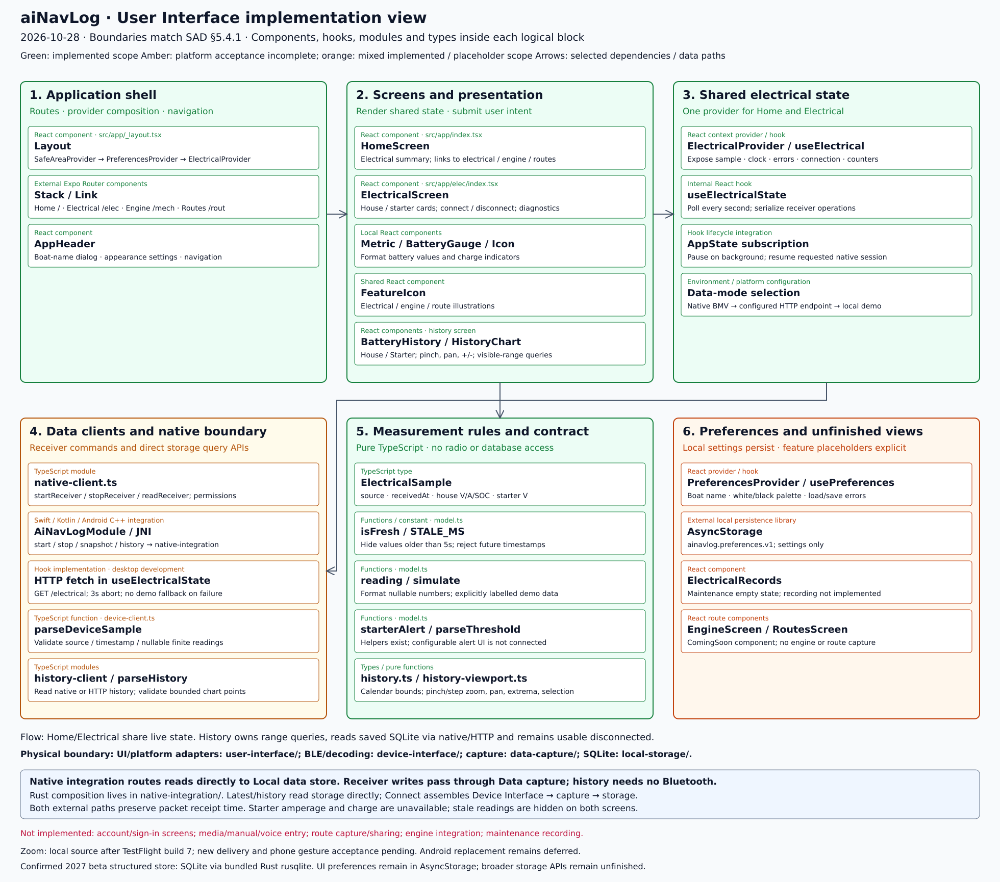

# User Interface implementation view

**Confirmed storage decision — October 28, 2026:** SQLite, accessed through Rust `rusqlite` with bundled SQLite, is the local structured database for the 2027 iOS/Android beta. See [ADR-0001](decisions/0001-sqlite-local-storage.md) for scope, current implementation and remaining work. Existing AsyncStorage preferences and protected credential storage remain separate.

Reviewed October 28, 2026 against `user-interface/src` and the native integration
module. This is an implementation overview of React components, hooks, modules
and types, grouped by responsibility; it is not a UML class diagram.
Its six groups match [SAD §5.4.1](../architecture.md#541-user-interface).

[Full-resolution PNG](images/user-interface-implementation-view.png) ·
[Zoomable SVG](images/user-interface-implementation-view.svg) ·
[Mermaid relationships](images/user-interface-implementation-view.mmd).
Regenerate with `python3 docs/diagrams/render-user-interface.py`.

| Logical group | Source implementation | Current scope |
| --- | --- | --- |
| 1. Application shell | [Layout](../user-interface/src/app/_layout.tsx), [AppHeader](../user-interface/src/components/AppHeader.tsx) | Stack navigation, provider composition, boat-name and appearance dialogs. |
| 2. Screens and presentation | [HomeScreen](../user-interface/src/app/index.tsx), [ElectricalScreen](../user-interface/src/app/elec/index.tsx), [FeatureIcon](../user-interface/src/components/FeatureIcon.tsx) | Shared electrical readings, battery presentation, native connection control, receiver counters and explicit errors. |
| 3. Shared electrical state | [ElectricalProvider / useElectrical](../user-interface/src/electrical/use-electrical.tsx) | One shared context; one-second foreground polling; serialized receiver commands; connection intent and foreground resumption. |
| 4. Data clients and native boundary | [native-client](../user-interface/src/electrical/native-client.ts), [sample validator](../user-interface/src/electrical/device-client.ts), HTTP fetch in the state hook | Native permissions/start/stop/snapshot, optional desktop HTTP path, sample validation. |
| 5. Measurement rules and contract | [model.ts](../user-interface/src/electrical/model.ts) | Nullable sample contract, freshness, number formatting, demo generation; threshold helpers exist but configurable alert UI is not connected. |
| 6. Preferences and unfinished views | [PreferencesProvider](../user-interface/src/preferences/Preferences.tsx), [ElectricalRecords](../user-interface/src/components/ElectricalRecords.tsx), [Engine](../user-interface/src/app/mech/index.tsx), [Routes](../user-interface/src/app/rout/index.tsx) | AsyncStorage settings persistence; explicit placeholders for unfinished feature screens. |

## Runtime and data modes

`Layout` mounts `PreferencesProvider` and `ElectricalProvider` above navigation.
Home and Electrical consume the same sample, clock and error state; navigating
between them does not create a second receiver provider.

| Mode | Selection | Data path |
| --- | --- | --- |
| Native simulator | Non-web platform with `EXPO_PUBLIC_NATIVE_BMV=1`; takes precedence | UI → `native-client` → `AiNavLogModule` → Rust integration; receiver → Data capture → Local data store; snapshot → validator → shared context. |
| Desktop HTTP | Native mode off and a nonempty `EXPO_PUBLIC_DEVICE_INTERFACE_URL`; ignored when `EXPO_PUBLIC_DEMO_MODE=1` | Hook fetch → Rust `serve-ui` → SQLite; JSON → validator → shared context. Requests abort after three seconds. |
| Local demo | Neither native nor HTTP mode selected | Hook calls `simulate()`; values are explicitly labelled sample readings. |

External reads preserve the original receipt time. `isFresh` accepts ages up to
five seconds and rejects future timestamps; both screens hide stale readings.
Configured native/HTTP errors do not fall back to generated demo values. Starter
current and SOC remain unavailable. The Home screen summarizes electrical data;
connection controls and receiver diagnostics are on Electrical.

Native Connect requests Android permissions before starting the receiver. The
provider serializes start/stop operations and retains connection intent while
backgrounded. Native wrappers also stop the receiver on background/destroy; on
foreground resumption the provider restarts a requested connection. UI connection
state is not proof that packets are arriving: diagnostics and freshness expose
that distinction. Phone SQLite is owned by the Rust Local data store; the History screen queries it read-only through the new native `history(start,end)` API, even when disconnected.

## Logical versus physical ownership

The native integration adapter is shared with the
[Device Interface implementation view](device-interface-implementation-view.md).
These two views show the same adapter from opposite sides of the interface.

| Physical location | Implementation responsibility |
| --- | --- |
| `user-interface/src/app/` | Routed screens and root layout. |
| `user-interface/src/components/` | Shared presentation, dialogs and placeholder components. |
| `user-interface/src/electrical/` | State provider, source selection, clients, contracts and display rules. |
| `user-interface/src/preferences/` | Local boat-name and appearance settings. |
| [iOS module](../user-interface/modules/ainavlog/ios/AiNavLogModule.swift) | Swift Expo boundary, private database path, authorization reporting and lifecycle. |
| [Android module](../user-interface/modules/ainavlog/android/src/main/java/expo/modules/ainavlog/AiNavLogModule.kt), [JNI bridge](../user-interface/modules/ainavlog/android/src/main/cpp/bridge.cpp) | Kotlin Expo boundary and JNI calls to Rust. |
| `native-integration/` | Rust C ABI, sessions, worker and query/application composition. |
| `device-interface/` | Bluetooth access, event handling, decoding, normalization and receiver state. |
| `data-capture/` | Validate observations and coordinate committed writes. |
| `local-storage/` | SQLite schema, transactions and latest/history queries. |
| `data-model/` | Shared record/error contracts and injected capture sink. |

## Current limits

Boat name and white/black appearance persist in AsyncStorage under
`ainavlog.preferences.v1`. This is separate from observation SQLite. There is no
implemented account/sign-in screen, media/manual/voice entry, route capture or
sharing, engine integration, maintenance recording. Historical queries/chart rendering are implemented in source; mobile runtime acceptance remains pending.
Maintenance shows an empty state; Engine and Routes use `ComingSoon`. Historical Usage is implemented in source with native/HTTP persisted-data queries and a labelled illustrative demo mode. Mobile acceptance awaits replacement native builds.

Owner-confirmed iPhone build 6 simulator reception and Android code 7 emulator
initialization are recorded in the [handoff](status/status-2026-10-26.md).
Physical Android testing is deferred while the tablet is unavailable. Full
permission/recovery/restart acceptance remains pending per platform. This view
does not claim real BMV/Orion interoperability or background recording.

## Historical Usage implementation — October 28

[BatteryHistory](../user-interface/src/components/BatteryHistory.tsx) implements the
[approved mockup](mockups/battery-history.png): House/Starter, local-calendar
24-hour/7-day/30-day windows, previous/later dates, charge/voltage/current for House
and voltage-only Starter, recorded-range extrema, tap/previous/next inspection,
loading/empty/error/retry states and explicit source labels. It owns its own query
state rather than reusing latest-sample polling. Refresh manually or on app resume.

`history-client` selects the existing native/HTTP/demo mode. Persisted-history
failures never create demo history; old native modules show an upgrade message.
The bridge reads the existing database without starting the scanner. Chart samples
retain packet timestamps and values; long ranges keep bucket endpoints and extrema.
Segments split at gaps over five seconds or measurement availability changes.
History is not subject to the live five-second hiding rule. Maintenance stays
unimplemented. A replacement native binary is required for the new method.

Verified browser previews (temporary seeded SQLite through the real Rust service):
[House](images/battery-history-implemented.png) ·
[Starter](images/battery-history-starter-implemented.png). These show the implemented
component, not the design mockup or a physical-phone acceptance run.

## Responsibility split

[SAD §5.2](../architecture.md#52-building-block-responsibilities) and
[ADR-0002](decisions/0002-capture-storage-boundaries.md) define the implemented
boundaries. Native latest/history reads route directly to Local data store,
bypassing capture and Bluetooth. Connect assembles Device Interface → capture →
storage. The bridge's physical Rust package is `native-integration/`, not nested
under Device Interface. Platform wrappers remain in the UI package.

**Delivery update — October 28:** iPhone 1.0.0/build 7 compiled and its exact
TestFlight submission finished successfully, including the history API and
responsibility refactor. Physical-phone regression remains pending. Existing
Android code 7 predates these changes; its replacement is deferred until the
physical tablet arrives. See the [release checkpoint](status/status-2026-10-28.md).

## History zoom — post-build-7 source update

[Viewport rules](../user-interface/src/electrical/history-viewport.ts) provide
bounded integer-millisecond windows, halving/doubling, hour/five-minute button
steps and panning. [Gesture handling](../user-interface/src/electrical/use-history-gestures.ts)
uses React Native's responder system without adding a native library. Pinches
anchor under the fingers; buttons anchor on the selected sample. Horizontal drags
pan, vertical gestures retain page scrolling, cancellation discards the preview.
Windows are clamped to the full selected calendar period and a five-minute minimum.

`BatteryHistory` owns this viewport state independently of live electrical state.
It commits/query-loads once when a gesture ends, preserving selection where
possible and replacing stale responses safely. The existing native/HTTP history
API re-samples the visible interval, rather than stretching the original points.
Refresh and battery/metric switches retain zoom; date/period changes reset it.
Empty windows still permit pinch-out/pan recovery and have no invented values.
The time axis uses the whole selected calendar period, even if recording covers
only part of it. Visible-range summaries replace full-period summaries when zoomed.

These changes are local and not included in TestFlight 1.0.0 (7). The database and
native ABI are unchanged. New app delivery and physical iPhone gesture checks
remain pending.

At windows of one hour or less, selected readings and axis/range labels include seconds for individual-packet inspection.

The [five-minute zoom preview](images/battery-history-zoom.png) shows the implemented
controls with SQLite-backed simulator readings. Browser touch integration and
UI typecheck, lint and unit checks pass; physical iPhone acceptance remains pending.
